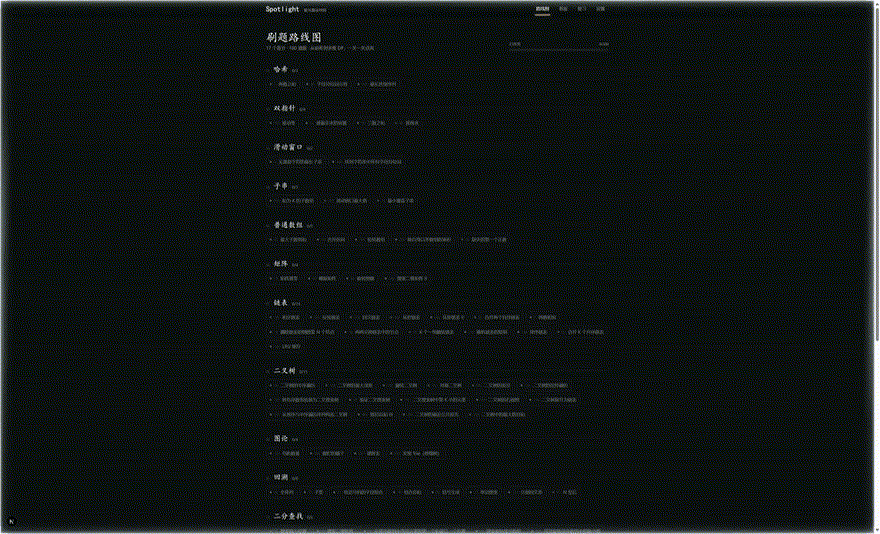

# AlgoStage · 算法讲台

> 像老师站在黑板前讲课一样学算法 —— AI 讲到哪，聚光灯打到哪。



AlgoStage 是一个**纯本地运行**的 LeetCode Hot 100 AI 学习系统：内置代码 playground、会讲课的 AI 导师（边讲边在页面上高亮当前位置、带华丽特效）、个人学习数据与看板。只需填入你自己的 **API Key + Model Name** 即可开始，无需任何服务器。

## 特性

- 🎯 **教鞭特效讲解**：AI 输出结构化讲解脚本，前端逐步播放 —— 聚光灯、粉笔划线、注意力涟漪、舞台压暗……讲到哪行代码，光就打在哪行
- 💻 **本地 Playground + 浏览器判题**：Monaco 编辑器；JS/TS 与 Python（Pyodide）在浏览器 Worker 中真实判题；JS/TS 提交时由服务端隔离复判。
- 🤖 **BYOK 内嵌 Agent**：填 API Key + model name 即用，基于 Vercel AI SDK，OpenAI / DeepSeek / Claude / Gemini 等几十家模型即插即用
- 📊 **个人看板**：刷题热力图、知识点掌握度、提示消耗、SM-2 间隔复习队列，全部存在本地 SQLite
- 🧩 **长期主义架构**：题目源、模型、特效、可视化器全部插件化，换数据源/换模型/加特效不动主框架
- 🔓 **开源合规**：不内置 LeetCode 题面原文，元数据 + 运行时客户端直取，见 [内容合规策略](docs/05-content-license.md)

## 快速开始

开发和验证请使用 **Node.js 22**（最低 22.12）；也支持 Node.js 24+。

```bash
npm ci                        # 按 package-lock.json 安装，与 CI 一致
cp .env.example .env          # 可选：也可以启动后在设置页填 Key（见下方三步）
npm run db:push && npm run db:seed   # 初始化本地 SQLite + 灌入 Hot 100
npm run dev                   # http://localhost:3000
```

想先看看效果：打开 <https://demo.m1ntch0c0.com/algostage>，选「两数之和」，这道题自带内置讲解（含全部特效），不需要 Key。

> ⚠️ 这是公共实例，设置页保存的 Key 对所有访客生效、掩码所有人可见。**不要在公共实例上填你自己的 Key。**

其余题目都要先配好 Key 才能讲解和要提示。请先按上面的步骤自托管或本地部署，再在你自己实例的设置页按三步填写：

1. **接口地址（base URL）**：先选服务商，再填对应地址。OpenAI 兼容服务留空时使用 `https://api.openai.com/v1`；Anthropic、Google 留空使用官方接口。
2. **API Key**：填写与上面接口同一来源的 Key，来源混用会被拒绝。
3. **模型名**：推荐 `gpt-6.1-sol`（设置页默认值）。较弱模型可能无法完成教案或正确调用教学工具，失败时请重试或更换模型。

保存前可以先点「测试连接」，确认能连上。

提示、讲课和测试连接遇到上游 401/403 时返回 HTTP 400 `UPSTREAM_AUTH`（`retryable: false`，提示「API Key 无效或没有权限」），不会自动重试。讲课 NDJSON 流开始后的错误事件仅含 `type: "error"`、`code`、`retryable`；首个步骤前的失败仍返回真实 HTTP 错误响应。

讲解通过五种教学工具逐步生成，收到步骤即可播放；只有完整教案校验成功才保存缓存。较弱模型可能无法完成讲解或正确调用工具，失败时建议重试或切换到 `gpt-6.1-sol`。备课总上限为 240 秒，非法工具参数最多重试该次调用 2 次，已完成步骤会保留。

使用环境变量 Key 时，请同时填写 `AI_BASE_URL`，并按服务商配置 `AI_PROVIDER`；设置页可单独覆盖模型名，接口和 Key 必须保持同一来源。设置页只保存实际修改的字段；保存新 Key 时请同时填写对应接口地址和服务商，来源混用会被拒绝，不会发出模型请求。

公网部署可用 `ALGOSTAGE_ALLOW_PRIVATE_BASE_URL=false` 禁止连接私网/回环接口地址，用 `ALGOSTAGE_DISABLE_SERVER_KEY=true` 让服务器不保存、不使用服务器 Key（用户在请求中自带 Key），详见 [deploy/README.md](deploy/README.md#环境变量自托管)。

验证命令：`npm run lint`、`npm run typecheck`、`npm test`、`npm run test:e2e`、`npm run build`。

## 从旧版本升级

```bash
npm ci
npm run db:push
```

v0.2.0 给 `Submission` 加了 `judgedBy`。保留旧库却不跑 `db:push` 时，学习看板会 500。补列不丢记录。Docker 启动会自动 `db push`。

## 判题

- 覆盖：Hot 100 前 20 题；2 秒超时；输出超 32 KiB → RE；支持 `class Solution`；Python 打开题目页预热。
- JS/TS：浏览器先跑 → `/api/judge` 服务端复判 → 仅服务端 AC 写进度。
- Python：服务端不可判，接受浏览器 AC（`judgedBy: client`）。
- 已 solved 不因 WA/RE/TLE 或重听课退回 learning。
- 构建自动 `build:judge`；`/judge/*` 需 COOP/COEP（Next 已加）。
- 可选环境变量 `JUDGE_MAX_CONCURRENCY`（默认 4，最大 64，按进程计）。

## Docker 自托管

```bash
docker buildx build --build-arg BASE_PATH=/algostage -t algostage:0.2.0-alpha.2 --load .
# 或
ALGOSTAGE_IMAGE_TAG=0.2.0-alpha.2 docker compose -f deploy/compose.yaml up -d --no-build --wait
```

需自备 API Key。镜像内 `DATA_DIR=/data`，数据库为 `/data/algostage.db`（挂载数据卷 `algostage-data`）；本地非 Docker 运行时默认用 `.env` 里的 `DATABASE_URL`（`file:./algostage.db`）。详见 [deploy/README.md](deploy/README.md)。

容器以非 root 用户 `algostage`（UID/GID `1001:1001`）运行。从 0.2.1 之前的版本升级时，旧数据卷归 root 所有，需先停旧容器、备份数据库，再执行一次：

```bash
docker run --rm -v algostage-data:/data alpine chown -R 1001:1001 /data
```

不处理时容器启动会报 `Error: data directory /data is not writable (uid 1001).` 并退出。

## 版本说明

- `v0.2.0-alpha.2` 指向 `7fd9024`。
- `v0.2.0-alpha.3`（Pre-release）指向 `32ad289`，在 alpha.2 基础上只修了 Docker 入口（Prisma 7 的 `db push` 去掉 `--skip-generate`）；该 tag 中 `package.json` 仍写 `0.2.0-alpha.1`。
- `m1-fixes` 分支的下一个版本是 v0.2.1；发版时 `package.json`、`deploy/compose.yaml` 镜像标签和 CHANGELOG 统一改为 `0.2.1`，在此之前分支内的版本号暂为 `0.2.0-alpha.2`。

## 子路径 + nginx

构建时设 `NEXT_PUBLIC_BASE_PATH`。讲解流 `application/x-ndjson`，需关代理缓冲（应用已发 `X-Accel-Buffering: no`）；`/algostage/api/lecture` 独立 location，读超时 300 秒。

## 提示超时

`.env` 可设 `HINT_TIMEOUT_MS`（默认 60000）。

## 文档

| 文档 | 内容 |
|---|---|
| [docs/00-research.md](docs/00-research.md) | 竞品与开源项目调研（站在哪些巨人肩膀上） |
| [docs/01-architecture.md](docs/01-architecture.md) | 总体架构与插件化扩展点（骨架设计） |
| [docs/02-frontend-design.md](docs/02-frontend-design.md) | **前端设计文档（核心）**：视觉语言、动效系统、特效清单、页面设计 |
| [docs/03-teaching-protocol.md](docs/03-teaching-protocol.md) | 讲解脚本协议：AI 如何描述"讲什么、指哪里、放什么特效" |
| [docs/04-data-model.md](docs/04-data-model.md) | 数据模型与看板指标 |
| [docs/05-content-license.md](docs/05-content-license.md) | 开源内容合规策略 |
| [docs/06-judge-design.md](docs/06-judge-design.md) | 判题分层设计：JudgeBackend 插件点与四个后端（浏览器沙箱/本机编译器/Judge0/LeetCode 远程） |

## 技术栈

Next.js (App Router) · TypeScript · Tailwind CSS v4 · Motion (Framer Motion) · Monaco Editor · Vercel AI SDK · Prisma + SQLite · Zustand

## 致谢与参考

[krahets/hello-algo](https://github.com/krahets/hello-algo) · [algorithm-visualizer](https://github.com/algorithm-visualizer/algorithm-visualizer) (MIT) · [doocs/leetcode](https://github.com/doocs/leetcode) · [karanb192/algo-sensei](https://github.com/karanb192/algo-sensei) · [HugeCatLab/ChatTutor](https://github.com/HugeCatLab/ChatTutor) · [CopilotKit](https://github.com/CopilotKit/CopilotKit) · [LeetCode-OpenSource/vscode-leetcode](https://github.com/LeetCode-OpenSource/vscode-leetcode)

## License

MIT（代码）。题目内容来源与合规说明见 [docs/05-content-license.md](docs/05-content-license.md)。
